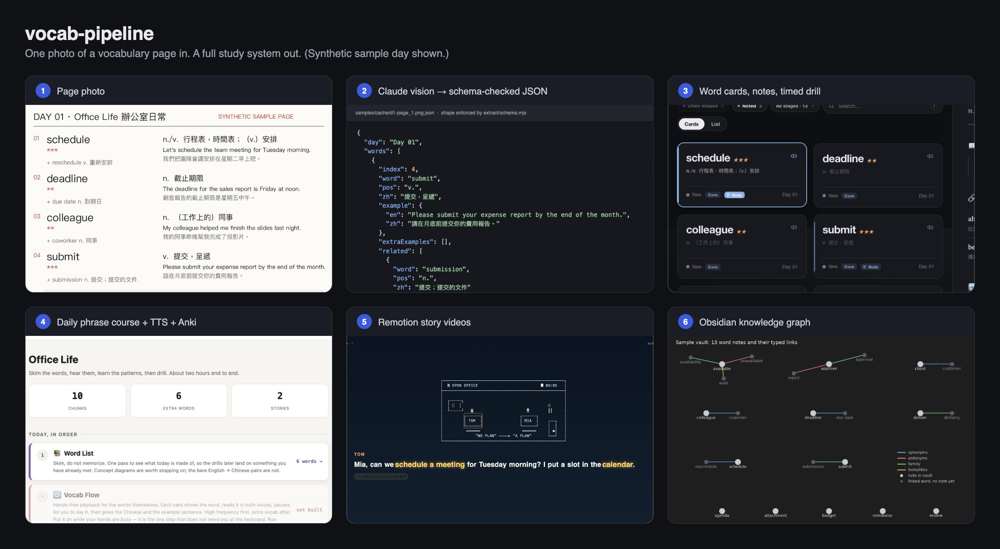
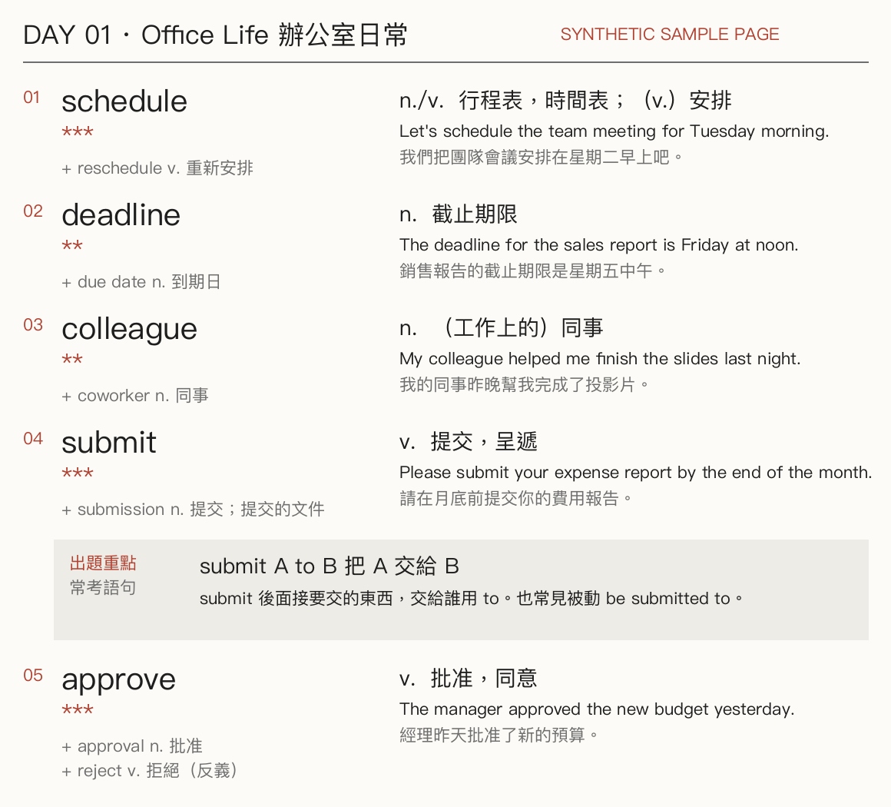
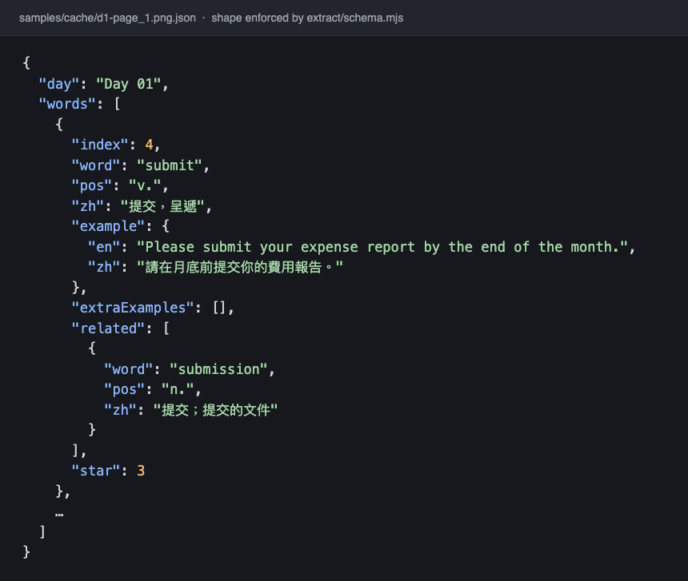
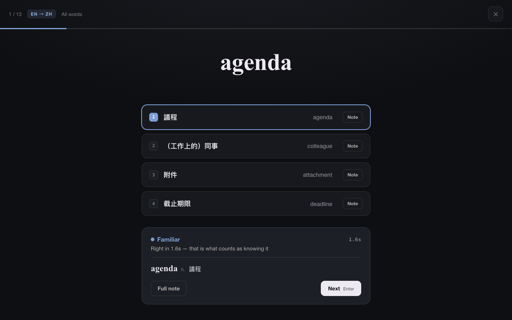
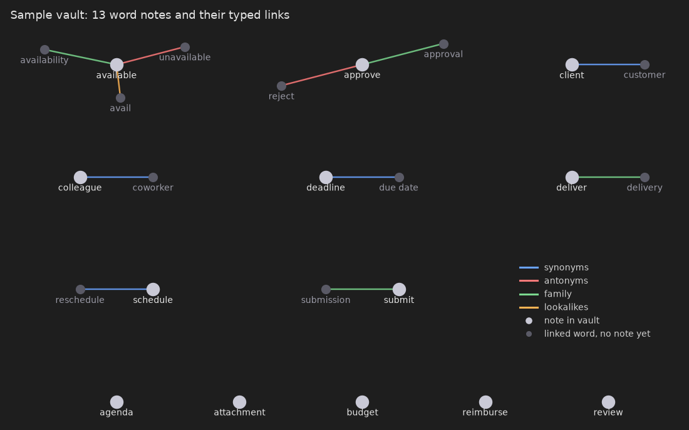
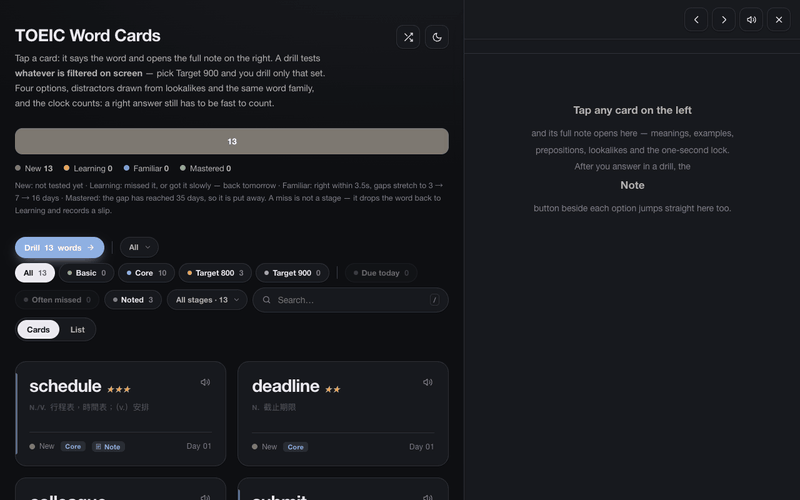
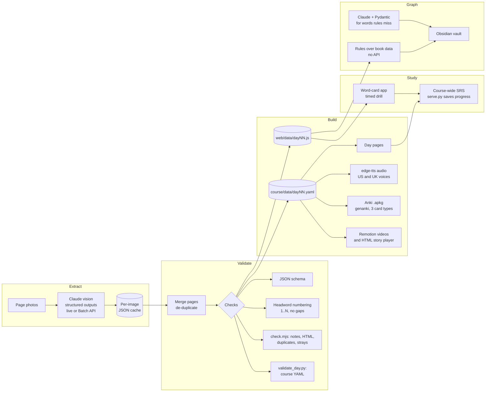

<h1 align="center">vocab-pipeline</h1>

<p align="center"><b>Photos of a paper vocabulary book in, a full study system out.</b><br>
Claude vision reads each page into schema-checked JSON. One dataset then feeds a study web app,
a daily phrase course with neural TTS audio, Anki decks, speed-aware spaced repetition,
Remotion story videos and an Obsidian knowledge graph.</p>

<p align="center">
  
  
  
  
  
  
  
  
  
</p>

<p align="center"></p>

I built this for my own TOEIC prep and I use it every day. On my machine it holds
the whole 30-day book: 472 page photos, 5,078 words and phrases, 2,394 detailed
word notes, 21 days of the audio course (about 16,000 clips and 21 Anki decks),
and a 5,083-note Obsidian graph.

This public repo has the code and a small synthetic sample. Every image below
comes from that sample, never from the book (see [Data and copyright](#data-and-copyright)).

## What it does

- **Reads book pages with a vision model.** One Claude request per photo, with the output shape enforced by a JSON schema (structured outputs). Live mode for one day, Message Batches API for the whole book.
- **Checks the data before anything uses it.** Schema, headword numbering continuity across pages, note shape and HTML, duplicates, words filed under the wrong day, and course YAML rules.
- **Builds a study web app.** Searchable word cards with full notes and a four-option timed drill. Distractors come from lookalikes and the same word family; a right answer has to be fast to count.
- **Builds a daily phrase course.** Day pages, chunk cards, neural TTS for every phrase and example in US and UK voices, and Anki decks with three card types.
- **Schedules reviews by answer speed.** A course-wide spaced repetition queue, saved to disk by a small local server.
- **Builds a knowledge graph.** One Obsidian note per word, linked as synonyms, antonyms, word family and lookalikes. Rules over the book data first; Claude plus Pydantic only where the rules run out.
- **Makes story videos.** Two-person dialogues that must use every word of the day, narrated, timed with ffprobe and rendered in Remotion.

## From photo to study system

<table>
  <tr>
    <th width="33%">1. Page photo</th>
    <th width="33%">2. Structured extraction</th>
    <th width="33%">3. Study web app</th>
  </tr>
  <tr>
    <td></td>
    <td></td>
    <td></td>
  </tr>
  <tr>
    <td>A synthetic page drawn by <code>samples/make_sample_pages.py</code> in a vocabulary-book layout.</td>
    <td>Per-image JSON in the shape set by <code>extract/schema.mjs</code>. The sample cache is hand-written so the demo runs offline; real runs write the same shape.</td>
    <td>Pages are merged, checked for gaps in headword numbers and written to <code>web/data/day01.js</code>.</td>
  </tr>
  <tr>
    <th>4. Timed drill</th>
    <th>5. Daily course</th>
    <th>6. Story player</th>
  </tr>
  <tr>
    <td></td>
    <td></td>
    <td></td>
  </tr>
  <tr>
    <td>Right in under 3.5 s moves a word forward (3, 7, 16, 35 days). Slow or wrong sends it back.</td>
    <td>Day YAML is validated, then rendered into pages, TTS audio and an Anki deck.</td>
    <td>Sentence-by-sentence playback with speed control, for shadowing.</td>
  </tr>
  <tr>
    <th>7. Remotion: ASCII stage</th>
    <th>8. Remotion: speed reader</th>
    <th>9. Knowledge graph</th>
  </tr>
  <tr>
    <td></td>
    <td></td>
    <td></td>
  </tr>
  <tr>
    <td>Dialogue scenes with the day's phrases highlighted in the captions.</td>
    <td>Words appear in time with the narration, played back at a fixed 155 words per minute.</td>
    <td>Typed links in the 13-note sample vault, plotted from the notes' frontmatter. In daily use I browse the full vault in Obsidian's graph view.</td>
  </tr>
</table>

<p align="center"><br>
<sub>The study web app on the sample day: open a note, step to the next word, start a drill, answer.</sub></p>

## Architecture



| Stage | Code | What it does |
|---|---|---|
| Extract | [`extract/parse.mjs`](extract/parse.mjs), [`extract/schema.mjs`](extract/schema.mjs) | One Claude vision request per photo with a JSON schema enforced by structured outputs. Live mode or Batch API. Results cached per image. Merges pages, de-duplicates, checks numbering, writes `web/data/dayNN.js`. |
| Validate | [`extract/check.mjs`](extract/check.mjs), [`course/scripts/validate_day.py`](course/scripts/validate_day.py) | Detail notes: shape of every block, allowed HTML tags and tag balance, duplicate keys across files, words filed under the wrong day. Course YAML: required fields, placeholder leftovers, cloze blanks that don't line up with the example, exactly 6 questions per story, valid answer indexes. |
| Study site | [`web/`](web) | Static word-card site. Filters by day, tier and stage. Four-option drill in both directions, with distractors drawn from lookalikes, the same word family and similar spellings. Grading is never self-rated: correct within 3.5 s moves a word forward (3 → 7 → 16 → 35 days), slow or wrong sends it back. |
| Course | [`course/`](course) | Phrase-based daily course: day page, core-chunk cards, word reference, Anki deck with Listening (audio → cloze), Recognition (EN → ZH) and Production (ZH + scenario → EN) cards, neural TTS for every chunk, example and story line. |
| Scheduling | [`course/static/srs.js`](course/static/srs.js), [`course/scripts/serve.py`](course/scripts/serve.py) | Course-wide review queue keyed `dayNN:id`. Answer time sets the interval: wrong 0.5 days, right but slower than 20 s 1 day, 10 to 20 s 2 days, under 10 s 3 days, then ×1.3 / ×1.9 / ×2.5. A small local server writes progress to files so it survives cleared browser data. |
| Graph | [`graph/vocab_graph.py`](graph/vocab_graph.py) | Obsidian note per word, linked as synonyms, antonyms, family and lookalikes. `build` mode uses rules over the book data, no API. `add` mode asks Claude, parses into Pydantic models, then drops phrases, self-links, words that are both synonym and antonym, and examples that don't contain the word. |
| Video | [`video/`](video) | Takes two-person dialogue scripts, checks that they use every word of the day, generates narration, measures each clip with ffprobe, and renders three Remotion compositions per episode plus a standalone HTML story player. |

## Key engineering decisions

**Claude vision with structured outputs, not text parsing.** The page schema in
`extract/schema.mjs` goes to the API as a JSON schema, so every page comes back
in the same shape with every required field. There is no regex parser to
maintain. The graph builder does the same in Python with a Pydantic model and
`messages.parse()`.

**Validation beyond the schema.** A schema can't tell you a page is missing.
Book headwords are numbered, so after merging, any gap in 1..N is printed with
the missing numbers, which tells me exactly which page to re-shoot or re-read.
The graph has its own semantic pass after Pydantic parsing: it drops phrases,
self-links, words listed as both synonym and antonym, and examples that don't
contain the word. A wrong link in a memory graph is worse than a missing one.

**Per-image cache.** Each photo's result is written to its own JSON file before
anything else happens. A crash, a rate limit or a re-run never pays for the
same image twice, and `--force` re-reads only the day I re-shot.

**Batch API for the whole book at about half the cost.** `--batch` submits all
photos through the Message Batches API: chunked by request count and payload
size, polled until done, results matched back by `custom_id` because order
isn't guaranteed. My estimate for the full book was about US$10 to 12 in live
mode and roughly half that in batch. That is an estimate from page counts and
token sizes, not a billing report. Live mode stays for checking one day and
seeing results immediately.

**No-API and API modes.** Parts that don't need a model don't call one. The
graph `build` mode turns the book's own related-word lists into links with
plain rules; `add` is only for words where the rules run out. The extractor
creates its API client lazily, so a fully cached run (like the demo) needs no
key. TTS uses free edge-tts by default and ElevenLabs for story audio only when
a key is present, with a per-clip fallback if a request fails.

**Prompts written from real failures.** Every rule in the extraction prompt
came from reading Day 01: boxes that continue from the previous page, the
half-visible neighbouring page at the spine, fingers and glare over text, words
with two parts of speech, examples the model "corrected".

**Grading by speed, not self-rating.** Both the drill and the course scheduler
use answer time. A correct but slow answer is treated as not yet known, so it
comes back sooner.

**Learning decisions with sources.** Synonyms and lookalikes are kept off the
same card (semantic interference research), one card tests one thing, pages
default to recall first. The reasoning is in [docs/DESIGN.md](docs/DESIGN.md).

**Built for a real user: me.** I use it daily for my own TOEIC study. Most of
the features above came from friction in that routine, and some were removed
for the same reason (the design notes list what was tried and dropped).

## Quickstart

Requirements: Node 20+, Python 3.11+. `ffmpeg` only for the video tools.

```sh
cd extract && npm install && cd ..
python3 -m venv .venv
.venv/bin/pip install -r course/requirements.txt -r graph/requirements.txt

PYTHON=.venv/bin/python ./demo.sh          # whole sample pipeline, offline, no API key
PYTHON=.venv/bin/python ./demo.sh --audio  # also TTS audio and the Anki deck (needs internet)
```

`demo.sh` runs extract (from the cached sample results), validation, the
graph build, course validation and the course build. Then open
`web/index.html` and `course/output/day01/index.html`. For progress that
persists to disk, run `python course/scripts/serve.py` and open
http://localhost:8137/.

With your own book:

```sh
cp .env.example .env                        # add ANTHROPIC_API_KEY
# photos go in pages/d1, pages/d2, ... (ignored by git)
node extract/parse.mjs d1                   # one day, live, check the output
node extract/parse.mjs --all --batch        # the rest, through the Batch API
node extract/check.mjs                      # after adding detail notes
python graph/vocab_graph.py build           # graph from book data
python graph/vocab_graph.py add -f graph/seed_words.txt   # model analysis for a few words
```

Video:

```sh
cd video && npm install && cd ..
python video/tools/build_story.py --day 01 --tts   # check word coverage, narrate, measure
python video/tools/build_player.py --day 01        # HTML story player
cd video && npm start                              # Remotion studio
```

## Project structure

```
extract/   photo -> structured data (Claude vision, cache, batch, continuity check, note checker)
web/       static word-card site and drill; data/ holds the sample day
graph/     knowledge graph builder (rules, or Claude + Pydantic) -> Obsidian
course/    phrase course: YAML -> pages, TTS, Anki, practice pages, SRS, local server
video/     story scripts -> narration -> Remotion compositions and HTML player
samples/   synthetic pages, cached results, generated vault
docs/      DESIGN.md and screenshots
demo.sh    offline run of the whole sample pipeline
```

## Data and copyright

The vocabulary book I study from is copyrighted. Its page photos, the extracted
word lists, notes, audio, decks, videos and vault built from them, the practice
question banks and my study progress all stay on my machine and are ignored by
git.

Everything in this repo is synthetic: ten ordinary office words I wrote myself,
rendered as fake book pages marked "SYNTHETIC SAMPLE PAGE". The cached "model
results" for those pages are hand-made so the demo runs without an API key;
they are not recorded API output. See [samples/README.md](samples/README.md).

The practice-page builder (`course/scripts/build_trr.py`) expects a full day
with four stories and a question bank, which the sample doesn't include.

## Roadmap

- Cross-day links in the course: when Day 15 teaches `certified`, point back to Day 01's `qualified` once the earlier word is stable.
- One master Anki package for all days.
- Mistake tracking from official practice tests, mapped back to the chunks that would have fixed each error.
- A weekly dashboard joining SRS retention with practice-test accuracy.
- An eval set of hand-checked pages to measure extraction accuracy per model.

## License

MIT. See [LICENSE](LICENSE).
