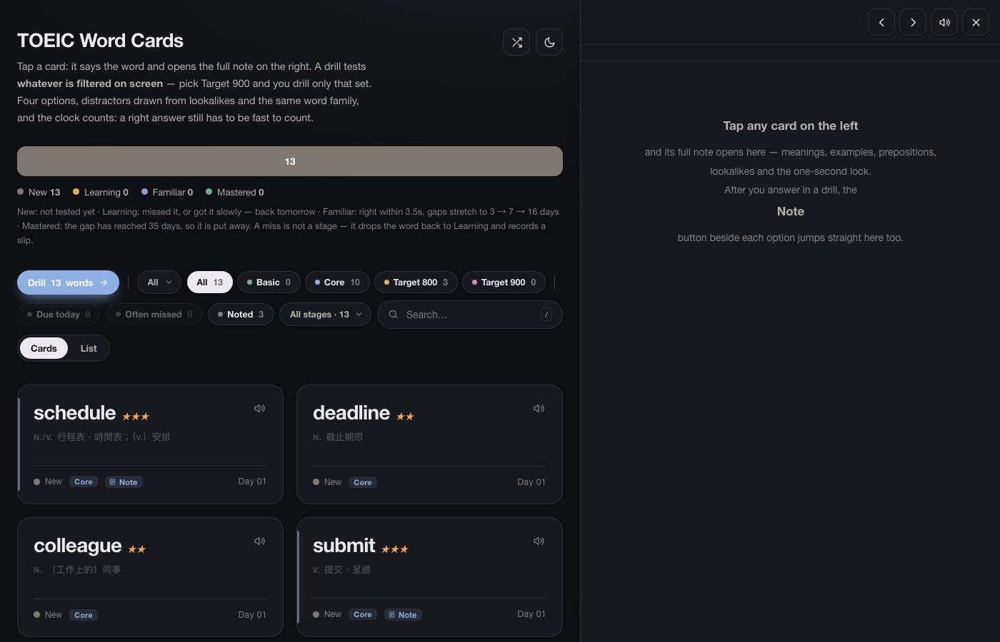
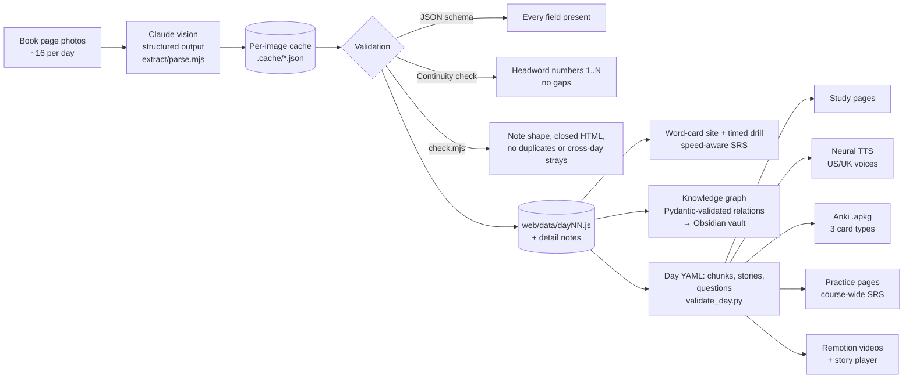
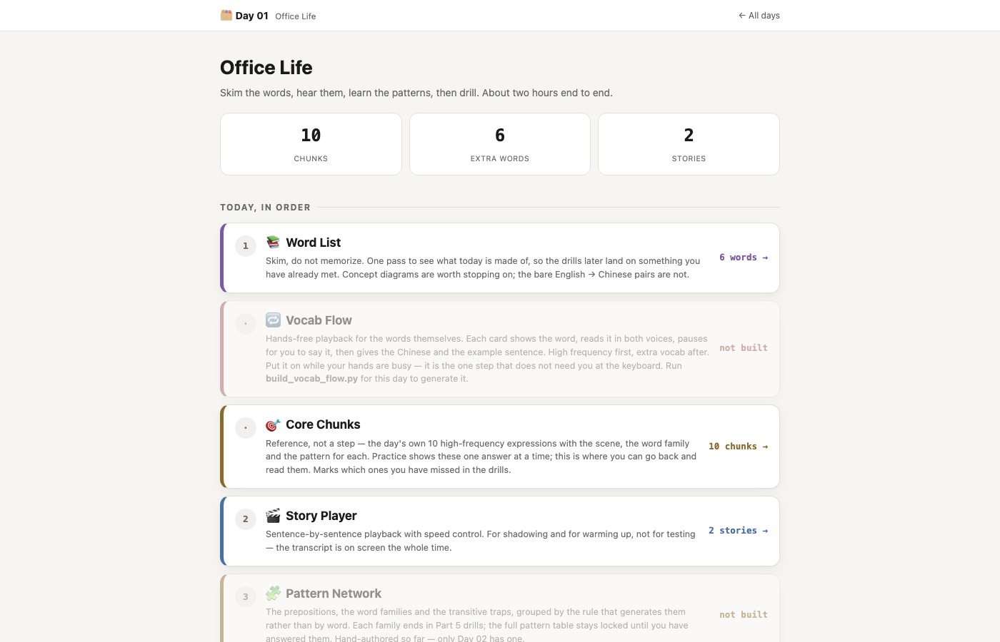
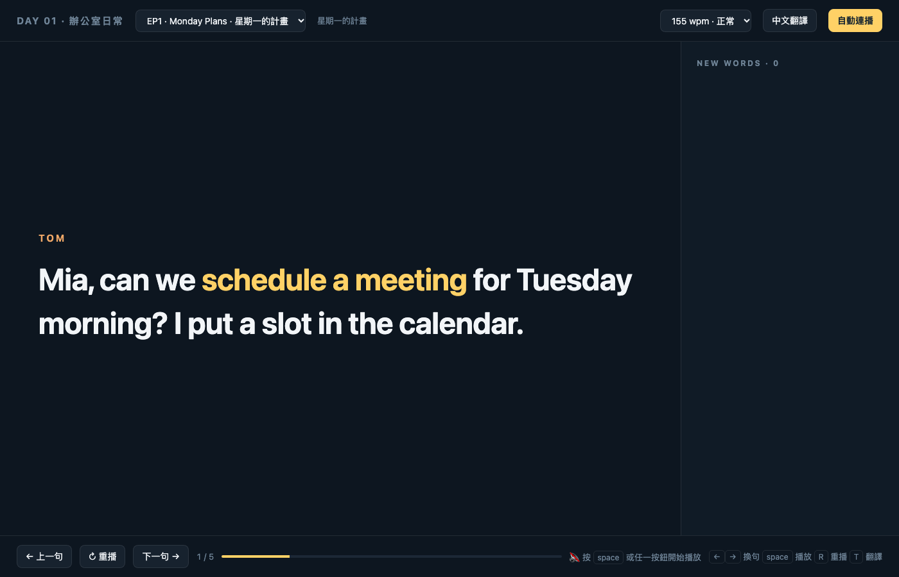

# vocab-pipeline

**Photos of a paper vocabulary book in, a full study system out.**
Claude reads each page photo into schema-checked JSON. From that one dataset the
pipeline builds a searchable word-card site with a timed drill, a phrase-based
daily course with neural TTS audio, Anki decks, speed-aware spaced repetition,
Remotion story videos and an Obsidian knowledge graph.

I built it for my own TOEIC prep and I use it every day. On my machine it holds
the whole 30-day book: 472 page photos, 5,078 words and phrases, 2,394 detailed
word notes, 21 days of the audio course (about 16,000 clips and 21 Anki decks),
and a 5,083-note Obsidian graph.

This public repo has the code and a small synthetic sample. The book itself is
copyrighted, so its photos and everything extracted from it stay private (see
[What's not here](#whats-not-here)).



## The problem

A good vocabulary book is still a passive object. You read it, you forget it.
What I wanted from the same pages:

- **Recall instead of rereading**: hide the answer, make me produce it, time me.
- **Listening**: hear every phrase in more than one accent, because the exam does.
- **A schedule**: bring back what I missed or answered slowly, across all 30 days, not just today's page.
- **Connections**: see that `defer`, `postpone` and `delay` belong together, and that `attendant` and `attendance` are a trap.

Typing 5,000 entries by hand was never going to happen. Reading the pages with a
vision model and treating the result as data made the rest possible.

## Pipeline



| Stage | Code | What it does |
|---|---|---|
| Extract | [`extract/parse.mjs`](extract/parse.mjs), [`extract/schema.mjs`](extract/schema.mjs) | One Claude vision request per photo with a JSON schema enforced by structured outputs. Live mode or Batch API. Results cached per image. Merges pages, de-duplicates, checks numbering, writes `web/data/dayNN.js`. |
| Validate | [`extract/check.mjs`](extract/check.mjs), [`course/scripts/validate_day.py`](course/scripts/validate_day.py) | Detail notes: shape of every block, allowed HTML tags and tag balance, duplicate keys across files, words filed under the wrong day. Course YAML: required fields, placeholder leftovers, cloze blanks that don't line up with the example, exactly 6 questions per story, valid answer indexes. |
| Study site | [`web/`](web) | Static word-card site. Filters by day, tier and stage. Four-option drill in both directions, with distractors drawn from lookalikes, the same word family and similar spellings. Grading is never self-rated: correct within 3.5 s moves a word forward (3 → 7 → 16 → 35 days), slow or wrong sends it back. |
| Course | [`course/`](course) | Phrase-based daily course: day page, core-chunk cards, word reference, Anki deck with Listening (audio → cloze), Recognition (EN → ZH) and Production (ZH + scenario → EN) cards, neural TTS for every chunk, example and story line. |
| Scheduling | [`course/static/srs.js`](course/static/srs.js), [`course/scripts/serve.py`](course/scripts/serve.py) | Course-wide review queue keyed `dayNN:id`. Answer time sets the interval: wrong 0.5 days, right but slower than 20 s 1 day, 10–20 s 2 days, under 10 s 3 days, then ×1.3 / ×1.9 / ×2.5. A small local server writes progress to files so it survives cleared browser data. |
| Graph | [`graph/vocab_graph.py`](graph/vocab_graph.py) | Obsidian note per word, linked as synonyms, antonyms, family and lookalikes. `build` mode uses rules over the book data, no API. `add` mode asks Claude, parses into Pydantic models, then drops phrases, self-links, words that are both synonym and antonym, and examples that don't contain the word. |
| Video | [`video/`](video) | Takes two-person dialogue scripts, checks that they use every word of the day, generates narration, measures each clip with ffprobe, and renders three Remotion compositions per episode plus a standalone HTML story player. |

| Course day page | Story player |
|---|---|
|  |  |

| Remotion: ASCII stage | Remotion: speed reader |
|---|---|
|  |  |

## Engineering decisions

**Structured outputs instead of parsing text.** The page schema in
`extract/schema.mjs` goes to the API as a JSON schema, so every page comes back
in the same shape with every required field. There is no regex parser to
maintain. The graph builder does the same thing in Python with a Pydantic model
and `messages.parse()`.

**Validation beyond the schema.** A schema can't tell you a page is missing.
Book headwords are numbered, so after merging, any gap in 1..N is printed with
the missing numbers, which tells me exactly which page to re-shoot or re-read.
The graph has its own semantic pass, because a wrong link in a
memory graph is worse than a missing one.

**Per-image cache.** Each photo's result is written to its own JSON file before
anything else happens. A crash, a rate limit or a re-run never pays for the
same image twice, and `--force` re-reads only the day I re-shot.

**Batch API at half price.** For the whole book, `--batch` submits all photos
through the Message Batches API: chunked by request count and payload size,
polled until done, results matched back by `custom_id` because order isn't
guaranteed. The full book was estimated at about US$10–12 in live mode and half
that in batch. Live mode stays for checking one day and seeing results
immediately.

**No-API and API modes.** The parts that don't need a model don't call one.
The graph `build` mode turns the book's own related-word lists into links with
plain rules; `add` is only for words where the rules run out. The extractor
creates its API client lazily, so a fully cached run (like the demo here) needs
no key. TTS uses free edge-tts by default and ElevenLabs for story audio only
when a key is present, with a fallback per clip if a request fails.

**Prompts written from real failures.** Every rule in the extraction prompt
came from reading Day 01: boxes that continue from the previous page, the
half-visible neighbouring page at the spine, fingers and glare over text,
words with two parts of speech, examples the model "corrected".

**Learning decisions with sources.** Synonyms and lookalikes are kept off the
same card (semantic interference research), one card tests one thing, pages
default to recall first. The reasoning is in [docs/DESIGN.md](docs/DESIGN.md).

## Run it

Requirements: Node 20+, Python 3.11+. `ffmpeg` only for the video tools.

```sh
cd extract && npm install && cd ..
python3 -m venv .venv
.venv/bin/pip install -r course/requirements.txt -r graph/requirements.txt

PYTHON=.venv/bin/python ./demo.sh          # whole sample pipeline, offline, no API key
PYTHON=.venv/bin/python ./demo.sh --audio  # also TTS audio and the Anki deck (needs internet)
```

Then open `web/index.html` and `course/output/day01/index.html`.
For progress that persists to disk, run `python course/scripts/serve.py` and open http://localhost:8137/.

With your own book:

```sh
cp .env.example .env                        # add ANTHROPIC_API_KEY
# photos go in pages/d1, pages/d2, ... (ignored by git)
node extract/parse.mjs d1                   # one day, live, check the output
node extract/parse.mjs --all --batch        # the rest, half price
node extract/check.mjs                      # after adding detail notes
python graph/vocab_graph.py build           # graph from book data
python graph/vocab_graph.py add -f graph/seed_words.txt   # model analysis for a few words
```

Video:

```sh
cd video && npm install && cd ..
python video/tools/build_story.py --day 01 --tts   # check word coverage, narrate, measure
python video/tools/build_player.py --day 01        # HTML story player
cd video && npm start                              # Remotion studio
```

## Layout

```
extract/   photo -> structured data (Claude vision, cache, batch, continuity check, note checker)
web/       static word-card site and drill; data/ holds the sample day
graph/     knowledge graph builder (rules or Claude + Pydantic) -> Obsidian
course/    phrase course: YAML -> pages, TTS, Anki, practice pages, SRS, local server
video/     story scripts -> narration -> Remotion compositions and HTML player
samples/   synthetic pages, cached results, generated vault
docs/      DESIGN.md and screenshots
```

## What's not here

Kept private on purpose: the book's page photos, the extracted word lists,
notes, audio, decks, videos and vault built from them, the practice question
banks, and my study progress. The sample day uses ten ordinary office words I
wrote myself, rendered as synthetic pages. The cached "model results" for those
pages are hand-made so the demo runs without an API key.

The practice-page builder (`course/scripts/build_trr.py`) expects a full day
with four stories and a question bank, which the sample doesn't include.

## Roadmap

- Cross-day links in the course: when Day 15 teaches `certified`, point back to Day 01's `qualified` once the earlier word is stable.
- One master Anki package for all days.
- Mistake tracking from official practice tests, mapped back to the chunks that would have fixed each error.
- A weekly dashboard joining SRS retention with practice-test accuracy.
- An eval set of hand-checked pages to measure extraction accuracy per model.

## License

MIT. See [LICENSE](LICENSE).
